# Aggregat

**A metadata index and agent knowledge base for unofficial firmware and tooling on Elektron devices** - in depth for the small boxes (Digitakt MKI/II, Digitone MKI/Keys/II, Syntakt, Analog Heat MKI/MKII/+FX), as a catalogue for Octatrack, Analog Rytm/Four/Keys, Model:Cycles/Samples, Machinedrum and Monomachine.

---

## Looking for something?

| You want | Read |
|---|---|
| **Mods and custom firmware** for your device, and the loaders that install them | [MODS.md](MODS.md) |
| **Development tools**: toolchains, emulators, firmware unpackers, protocol libraries, research | [DEV-TOOLS.md](DEV-TOOLS.md) |
| **Tools for musicians**: editors, sample/project managers, Overbridge audio, screen mirrors - nothing that changes firmware | [MUSICIAN-TOOLS.md](MUSICIAN-TOOLS.md) |
| **The same feature built more than once** (engines carried between boxes, compressors, scales, direct jump, load meters): where to start instead of from zero | [FEATURE-OVERLAP.md](FEATURE-OVERLAP.md) |
| Which entries are forks, copies, ports or builds of each other (so nothing is counted twice) | [PROJECT-FAMILIES.md](PROJECT-FAMILIES.md) |
| Everything for one device, with full notes | [INDEX.md](INDEX.md) |
| How the hardware works, for writing mods | [hardware/](hardware/README.md) |
| **What is known and what is still open, per device, plus a shared to-do and a prompt to start a research session** | [RESEARCH-MAP.md](RESEARCH-MAP.md) |
| **Help the research:** tests that take minutes on a stock unit, open tasks and shared goals, and how to take part with your own project | [RESEARCH-MAP.md](RESEARCH-MAP.md#help-with-a-test-no-flashing-needed), [research/](research/PARTICIPANTS.md) |
| **See the scene at a glance:** an interactive network map of projects, the people behind them, device families and how projects build on each other; a community page with new repos per week, projects per device, licences and the most active people | [Network map](https://70b185.github.io/Aggregat/?t=network), [Community](https://70b185.github.io/Aggregat/?t=community) |
| **Everything as one database** (projects, relations, rules, sources, conflicts, ~900 hardware facts with full-text search), for agents and scripts | [export/](export/README.md), or search it in the browser: [70b185.github.io/Aggregat](https://70b185.github.io/Aggregat/) |

All three lists are generated from [`data/projects.yml`](data/projects.yml); an entry's `kind` (or an explicit `list:` field) decides where it goes.

## How the projects relate

The [interactive network map](https://70b185.github.io/Aggregat/?t=network) shows the same relations together with the people (GitHub owners) and, if you like, the device families; click a project or a person for details. The static graph below is drawn by GitHub.

The graph shows the entries that are linked to another entry. A link is a fork, a copy, a port, a variant for another device, or a project that builds on, bundles or describes another one. An arrow points from an entry to the entry it names, for example from a fork to its original.

Each box groups the entries for one device family. An entry for more than one family is in "Several device families". Each node shows the licence the project states, or "not recorded" when the entry has no `license` field. Entries without a link are not in the graph. They are in the lists above.

`scripts/build.py` draws the graph again on each run, from the `relations:` and `license` fields in [`data/projects.yml`](data/projects.yml). Each relation names its evidence: GitHub's fork flag, or a file of the project such as its README. [PROJECT-FAMILIES.md](PROJECT-FAMILIES.md) lists each relation with its evidence. A relation of type `unclear` is not drawn, because no source states what it is.

To add a relation, add it to the entry in `data/projects.yml` and run `python3 scripts/build.py`:

```yaml
    relations:
    - {type: fork_of, id: <id of the other entry>, evidence: 'GitHub fork flag'}
```

The types are `fork_of`, `copy_of`, `port_of`, `variant_of`, `builds_on`, `same_project`, `bundles`, `describes` and `unclear`. Add a relation only when a source proves it, and name that source in `evidence`.

<!-- relation-graph:start - generated by scripts/build.py from data/projects.yml, do not edit by hand -->

70 entries with 54 relations. Colour: licence family (green permissive, blue copyleft, yellow public domain, grey none stated or not recorded).

```mermaid
flowchart LR
  subgraph n_group_Digitakt["Digitakt"]
    n_digifilter["DigiFilter<br/>GPL-2.0-or-later"]:::copyleft
    n_digiseq_digitakt["DIGISEQ (Digitakt)<br/>GPL"]:::copyleft
    n_digisnake_digitakt["DIGISNAKE (Digitakt)<br/>GPL"]:::copyleft
    n_digisophie["Digisophie / Sophie for Digitakt<br/>not recorded"]:::none
    n_digitakt_sidecar_pi["Digitakt integrated sidecar<br/>not stated"]:::none
    n_digitakt_pattern_editor_juce["Digitakt Pattern Editor (JUCE)<br/>BSD-2-Clause"]:::permissive
    n_digitakt_ii_research["digitakt-ii-research<br/>MIT"]:::permissive
    n_digitakt_reorder["digitakt-reorder<br/>MIT"]:::permissive
    n_directjump_digitakt["DIRECT JUMP (Digitakt)<br/>GPL"]:::copyleft
    n_dt_fm["DT-FM<br/>MIT, part GPL-2.0-or-later"]:::copyleft
    n_dt2_capicola["dt2-capicola<br/>not recorded"]:::none
    n_dt2_machine_lab["dt2-machine-lab<br/>not stated"]:::none
    n_elk_herd["elk-herd<br/>BSD-2-Clause (per other projects)"]:::permissive
    n_keyframer_lab["Frame Lab (keyframer-lab)<br/>AGPL"]:::copyleft
    n_pump_digitakt["PUMP (Digitakt)<br/>GPL"]:::copyleft
    n_screendump["screendump<br/>MIT"]:::permissive
    n_sidecar_digitakt["Sidecar (Digitakt mod)<br/>GPL"]:::copyleft
  end
  subgraph n_group_Digitone["Digitone"]
    n_digiseq_digitone["DIGISEQ (Digitone)<br/>GPL"]:::copyleft
    n_digisnake_digitone["DIGISNAKE (Digitone)<br/>GPL"]:::copyleft
    n_directjump_digitone["DIRECT JUMP (Digitone)<br/>GPL"]:::copyleft
    n_dn2mk2["DN2 mk2 Mod (dn2mk2-firmware)<br/>AGPL-3.0-or-later"]:::copyleft
    n_dn2_cfw["dn2-cfw<br/>not recorded"]:::none
    n_dn2_firmware_explore["dn2_firmware_explore<br/>AGPL-3.0-or-later"]:::copyleft
    n_pump_digitone["PUMP (Digitone)<br/>GPL"]:::copyleft
  end
  subgraph n_group_Syntakt["Syntakt"]
    n_synfact["Synfact<br/>GPL-2.0 (old release repo MIT)"]:::copyleft
    n_synthack_os_upstream["SyntHack OS (upstream)<br/>MIT"]:::permissive
    n_synthack_os["Synthack-OS<br/>not recorded"]:::none
  end
  subgraph n_group_Octatrack["Octatrack"]
    n_acidtrack_modules["aCiDtRacK modules<br/>MIT"]:::permissive
    n_midisc["midisc<br/>MIT"]:::permissive
    n_midisc_patcher["midisc-patcher<br/>not stated"]:::none
    n_octa_panel["octa-panel<br/>MIT"]:::permissive
    n_octabam["octabam<br/>MIT"]:::permissive
    n_octatrack_modules_radiohagen["Octatrack modules<br/>not recorded"]:::none
    n_passos["PassOS<br/>MIT"]:::permissive
    n_rebirth2octatrack["ReBirth to Octatrack<br/>not recorded"]:::none
    n_trackpatterns["TrackPatterns<br/>MIT"]:::permissive
  end
  subgraph n_group_Analog_Rytm["Analog Rytm"]
    n_libanalogrytm["libanalogrytm<br/>MIT"]:::permissive
    n_rytm_mods_src["rytm-mods-src<br/>GPL-2.0-only"]:::copyleft
    n_rytm_rs["rytm-rs / rytm-sys<br/>MIT"]:::permissive
    n_rytm1_mods["rytm1_mods<br/>not stated"]:::none
    n_rytm2_mods["rytm2_mods<br/>GPL"]:::copyleft
  end
  subgraph n_group_Model["Model"]
    n_bias["BIAS<br/>MIT"]:::permissive
    n_chord_keys["Chord Keys<br/>not stated"]:::none
    n_cycles_engines["Cycles Engines<br/>not recorded"]:::none
    n_cycles_mod_standard["Cycles Mod Standard<br/>MIT"]:::permissive
    n_modded_cycles["Modded Cycles<br/>MIT"]:::permissive
    n_model27["model27<br/>MIT"]:::permissive
    n_model909["model909<br/>MIT"]:::permissive
    n_spokes["SPOKES<br/>MIT"]:::permissive
    n_supermodel_edition["Supermodel Edition<br/>not stated"]:::none
  end
  subgraph n_group_Machinedrum["Machinedrum"]
    n_machinemodule_desktop["MachineModule (desktop)<br/>AGPL-3.0"]:::copyleft
    n_machinemodule_mpc["Machinemodule for MPC OS<br/>AGPL-3.0"]:::copyleft
    n_mds["MDS (Machine Dump Standard)<br/>not stated"]:::none
    n_mds_tools["mds-tools<br/>GPL"]:::copyleft
    n_mmodule["MoDule (MD Drums)<br/>GPL"]:::copyleft
    n_moduledrum["ModuleDrum<br/>AGPL-3.0"]:::copyleft
  end
  subgraph n_group_Monomachine["Monomachine"]
    n_monomodule["Monomodule<br/>AGPL-3.0-only"]:::copyleft
    n_schwung_monomodule["Monomodule for Schwung<br/>GPL-3.0 per README (repo metadata: AGPL-3.0)"]:::copyleft
  end
  subgraph n_group_Several_device_families["Several device families"]
    n_digi_roll_studio["digi-roll-studio<br/>not recorded"]:::none
    n_digikit["digikit<br/>AGPL-3.0-or-later with extra terms"]:::copyleft
    n_dn2_dt2_firmware_research["DN2 DT2 firmware research<br/>not recorded"]:::none
    n_elek_view["Elek View<br/>GPL-3.0"]:::copyleft
    n_elekloader["elekloader<br/>GPL-2.0-or-later"]:::copyleft
    n_elekloader_simonjohansson["elekloader<br/>GPL-2.0-or-later"]:::copyleft
    n_elektron_firmware_tool["elektron-firmware-tool<br/>not recorded"]:::none
    n_elektron_screen_tool["Elektron-Screen-Tool<br/>MIT"]:::permissive
    n_filter_plus["Filter+ (13 filter types)<br/>GPL-2.0-or-later"]:::copyleft
    n_gearmulator_md_mm["Gearmulator MD/MM<br/>GPL-3.0-only"]:::copyleft
    n_maschine_md_mm["Maschine MD-MM<br/>GPL-3.0"]:::copyleft
    n_sidecar_expander["Sidecar | Expander<br/>GPL-2.0"]:::copyleft
  end
  n_digitakt_ii_research -- "builds on" --> n_digikit
  %% evidence: all-in-one/README.md: modified firmware derived from digikit; uses its patchkit
  n_digitakt_ii_research -- "vendors code from" --> n_elektron_firmware_tool
  %% evidence: catalogue notes: elektron-firmware-tool (vendored)
  n_dn2_dt2_firmware_research -- "builds on" --> n_dn2_firmware_explore
  %% evidence: catalogue notes: builds on dnfw (pinned commit)
  n_dn2_dt2_firmware_research -- "builds on" --> n_digikit
  %% evidence: catalogue notes: builds on digikit (pinned commit)
  n_dn2_dt2_firmware_research -- "builds on" --> n_elektron_firmware_tool
  %% evidence: catalogue notes: builds on elektron-firmware-tool (pinned commit)
  n_synthack_os -- "fork of" --> n_synthack_os_upstream
  %% evidence: GitHub fork flag
  n_filter_plus -- "builds on" --> n_digifilter
  %% evidence: same author; BP/BP2/COMB/TRASH are DigiFilter modes; LICENSE names the DigiFilter authors
  n_dt_fm -- "builds on" --> n_digisophie
  %% evidence: notes
  n_elek_view -- "port of" --> n_screendump
  %% evidence: README: a .html implementation of jakobbak/screendump
  n_dt2_machine_lab -- "bundles" --> n_dt2_capicola
  %% evidence: machines/capicola-reddit/upstream keeps its 66 files byte-exact
  n_dn2_cfw -- "vendors code from" --> n_digikit
  %% evidence: catalogue notes: upstream cloned into vendor/ (author's fork, branch dn2-1.12)
  n_dn2_cfw -- "vendors code from" --> n_elekloader
  %% evidence: catalogue notes: upstream cloned into vendor/ (author's fork, branch dn2-1.12)
  n_dn2mk2 -- "builds on" --> n_dn2_firmware_explore
  %% evidence: docs/CHANGES-FROM-UPSTREAM: forked dnfw at 8c40698
  n_elekloader_simonjohansson -- "fork of" --> n_elekloader
  %% evidence: GitHub fork flag
  n_elekloader_simonjohansson -- "vendors code from" --> n_digikit
  %% evidence: catalogue notes: NOTICE covers digikit code
  n_digi_roll_studio -- "vendors code from" --> n_elk_herd
  %% evidence: catalogue notes: protocol code ported from elk-herd
  n_rytm1_mods -- "port of" --> n_rytm_mods_src
  %% evidence: README: port of the MKII project to the MK1
  n_mds_tools -- "builds on" --> n_mds
  %% evidence: README: tools for the MDS specification
  n_chord_keys -- "fork of" --> n_modded_cycles
  %% evidence: GitHub fork flag
  n_model27 -- "fork of" --> n_modded_cycles
  %% evidence: own README: beta fork of Modded Cycles 1.55
  n_spokes -- "bundles" --> n_modded_cycles
  %% evidence: README table
  n_spokes -- "bundles" --> n_model27
  %% evidence: README table
  n_spokes -- "bundles" --> n_supermodel_edition
  %% evidence: README table
  n_supermodel_edition -- "fork of" --> n_modded_cycles
  %% evidence: GitHub fork flag
  n_midisc_patcher -- "builds on" --> n_midisc
  %% evidence: README: patcher for the 1.40MIDISC build
  n_octa_panel -- "copy of" --> n_octabam
  %% evidence: repo content is octabam (README, modules) as of 2026-10-13
  n_passos -- "builds on" --> n_octabam
  %% evidence: README
  n_synfact -- "builds on" --> n_elekloader
  %% evidence: README of synfact-dev: built on elekloader, its engine, file format and checks
  n_digiseq_digitone -- "variant of" --> n_digiseq_digitakt
  %% evidence: same author, Digitone build
  n_pump_digitone -- "variant of" --> n_pump_digitakt
  %% evidence: same author, Digitone build
  n_directjump_digitone -- "variant of" --> n_directjump_digitakt
  %% evidence: same author, Digitone build
  n_digisnake_digitone -- "variant of" --> n_digisnake_digitakt
  %% evidence: same author, Digitone build
  n_sidecar_digitakt -- "variant of" --> n_sidecar_expander
  %% evidence: same author, Digitakt side of Sidecar
  n_digitakt_sidecar_pi -- "builds on" --> n_sidecar_expander
  %% evidence: README: based on Sidecar by Trig Condition
  n_elektron_screen_tool -- "fork of" --> n_screendump
  %% evidence: README
  n_dt2_capicola -- "builds on" --> n_keyframer_lab
  %% evidence: same Capicola keyframe engine by Heavylight Industries
  n_rytm2_mods -- "port of" --> n_rytm_mods_src
  %% evidence: README: ported to elemod
  n_mmodule -- "builds on" --> n_gearmulator_md_mm
  %% evidence: README: MD Drums came from gearmulator-md-mm
  n_cycles_engines -- "builds on" --> n_modded_cycles
  %% evidence: README credits
  n_cycles_engines -- "builds on" --> n_model27
  %% evidence: README credits
  n_cycles_mod_standard -- "describes" --> n_model27
  %% evidence: README: implemented in model27
  n_model909 -- "builds on" --> n_modded_cycles
  %% evidence: README: built on Modded-Cycles and Model-TG
  n_octatrack_modules_radiohagen -- "builds on" --> n_octabam
  %% evidence: README
  n_rebirth2octatrack -- "builds on" --> n_octabam
  %% evidence: README: targets the GARDEN engines
  n_moduledrum -- "fork of" --> n_monomodule
  %% evidence: README
  n_machinemodule_desktop -- "port of" --> n_machinemodule_mpc
  %% evidence: README
  n_schwung_monomodule -- "port of" --> n_monomodule
  %% evidence: README
  n_trackpatterns -- "builds on" --> n_octabam
  %% evidence: README: also submitted as octabam PR 846
  n_acidtrack_modules -- "builds on" --> n_octabam
  %% evidence: README
  n_maschine_md_mm -- "fork of" --> n_gearmulator_md_mm
  %% evidence: README
  n_rytm_rs -- "builds on" --> n_libanalogrytm
  %% evidence: README
  n_digitakt_pattern_editor_juce -- "port of" --> n_elk_herd
  %% evidence: README: format layer ported to C++ from elk-herd
  n_digitakt_reorder -- "builds on" --> n_elk_herd
  %% evidence: README: works on .syx dumps fetched and sent with elk-herd
  n_bias -- "builds on" --> n_model27
  %% evidence: altstrument: a machine package for model27; its scripts clone model27 at a pinned commit
  classDef permissive fill:#d9f2e3,stroke:#2b7a4b,color:#10301e
  classDef copyleft fill:#dde7fb,stroke:#3460b0,color:#13254a
  classDef public-domain fill:#f9ecc8,stroke:#a07410,color:#3d2c05
  classDef none fill:#ececec,stroke:#7a7a7a,color:#2a2a2a
```



<!-- relation-graph:end -->

## What is in here

| Path | What it is | Who it is for |
|---|---|---|
| [`INDEX.md`](INDEX.md) | Overview: projects per device, verified vs. unverified | everyone |
| [`devices/`](devices/) | One generated page per device: table of projects with kind, status, OS, last activity, links | developers looking for a tool or mod |
| [`data/projects.yml`](data/projects.yml) | The source of truth: one entry per project (repo, links, status, base OS, version, notes, sources) | contributors, scripts |
| [`data/candidates.yml`](data/candidates.yml) | Entries seen in other directories but not yet checked against their repo | contributors |
| [`data/devices.yml`](data/devices.yml) | Device catalogue and scope phases | scripts |
| [`hardware/`](hardware/) | **Knowledge base for AI agents**: rules, recovery, firmware container, memory maps, toolchains, per-device internals - every fact with an evidence tag and a source | agents and humans writing mods |
| [`state/CHANGES.md`](state/CHANGES.md) | Latest change report from the fingerprint check - **read this first when updating** | agents, maintainers |
| [`docs/UPDATING.md`](docs/UPDATING.md) | Token-cheap update procedure (fingerprints, diffs, daily GitHub Action) | agents, maintainers |
| [`docs/BACKLOG.md`](docs/BACKLOG.md) | Research backlog and phase-2 devices | maintainers |
| [`scripts/build.py`](scripts/build.py) | Regenerates `INDEX.md`, `devices/*.md` and the three lists from `data/` | maintainers |

Snapshot (2026-11-02): 199 project entries for 13 devices (115 mods/firmware/loaders, 53 development tools, 27 musician tools); `hardware/` holds about 35 files with rules A1-A38, drawn from more than 70 repositories, two directories, official release notes and forum threads.

## Using it with an AI agent

Point the agent at this repo and tell it to read, in this order (for open-ended research, start with the ready-made prompt in [RESEARCH-MAP.md](RESEARCH-MAP.md) instead):

1. [`hardware/README.md`](hardware/README.md) - the ten things to know first
2. [`hardware/AGENT-RULES.md`](hardware/AGENT-RULES.md) - safety, legal, process and coding rules
3. [`hardware/common/recovery.md`](hardware/common/recovery.md) and [`hardware/common/flash-procedure.md`](hardware/common/flash-procedure.md)
4. the device file under [`hardware/devices/`](hardware/devices/)
5. [`INDEX.md`](INDEX.md) / [`devices/`](devices/) to find the project it builds on

**Starting a new project with this repo?** Copy [`research/AGGREGAT_RESEARCH.md`](research/AGGREGAT_RESEARCH.md) into the root of the new project on day one, and have your agent keep its results table up to date. It holds a copy of the shared goals, tasks and tests as of the day you started, so your findings stay comparable, and we merge your results back (by hand, with credit) when we update. Optional, but it is how one project's finding helps all the others. See [research/PARTICIPANTS.md](research/PARTICIPANTS.md).

Evidence tags used throughout `hardware/`: `[hw]` reported working on a real unit, `[emu]` emulator only, `[doc]` stated without a test result, `[?]` unclear or inferred. Everything is **second-hand** - verify addresses and byte patterns against the original source before relying on them. Source keys like `{dn2-ele3}` resolve in [`hardware/SOURCES.md`](hardware/SOURCES.md); what was read and how deeply is in [`hardware/READING-LEDGER.md`](hardware/READING-LEDGER.md).

## Ground rules

- **Metadata only.** Names, links, status, short paraphrased notes. No Elektron firmware, no extracted sections, no built images, no binaries, no copied third-party code. Never commit a `.syx`.
- **Every entry has a source and a date.** Status words follow the authors' own wording; where sources disagree, the note says so.
- **Respect the communities.** Elektron does not allow firmware-mod links or files on Elektronauts (policy of 2026-09-16) - do not post there. Some projects reject AI-generated issues or pull requests; read each project's contribution rules first.
- **Not affiliated with Elektron.** Custom firmware can brick a unit and may affect warranty. This repo only points to projects; it does not endorse or test them.

## Updating the data

```bash
pip install pyyaml
# edit data/projects.yml (or move an entry from data/candidates.yml once checked)
python3 scripts/build.py      # regenerates INDEX.md and devices/*.md
```

Entry fields are documented at the top of `data/projects.yml`. To find out *what* needs updating, run `python3 scripts/check_updates.py` (or read `state/CHANGES.md`, written daily by the GitHub Action) - see [`docs/UPDATING.md`](docs/UPDATING.md). Generated files carry a marker - edit the YAML, not the Markdown.

## Status and scope

- **Phase 1 (in depth):** Digitakt MKI/II, Digitone MKI/Keys/II, Syntakt, Analog Heat MKI/MKII/+FX: project catalogue plus the agent knowledge base in [`hardware/`](hardware/).
- **Phase 2 (catalogue, since 2026-11-01):** Octatrack, Analog Rytm, Analog Four/Keys, Model:Cycles, Model:Samples, Machinedrum, Monomachine: 45 projects imported from altstrument as facts with our own short notes, watched daily; repos not yet read, no hardware notes yet. Tonverk and non-Elektron gear: see [`docs/BACKLOG.md`](docs/BACKLOG.md).
- **Known gap:** no community firmware work exists for the Analog Heat yet; only official facts, Overbridge channel layout and tool support lists are collected.
- **Open reading list:** [`hardware/MINING.md`](hardware/MINING.md) (e.g. the MIDI appendices of the official manuals, which our tooling could not extract).

## Related directories

- [Awesome Music Gear Firmware](https://github.com/Lapin/awesome-music-gear-firmware) - curated link list across 19 brands (CC0)
- [altstrument](https://altstrument.org) / [repo](https://github.com/philmillman/altstrument) - structured directory of alternative firmware (CC-BY-4.0 data)
- [elektronmods.com](https://elektronmods.com) - community forum and GitHub mod list for Elektron devices

Aggregat differs from these by focusing on a few devices in depth: current version and OS per project, and an agent-readable hardware knowledge base.

## Licence

Everything in this repository - texts, data and scripts - is dedicated to the public domain under
[CC0 1.0 Universal](LICENSE). Use it for anything, no attribution required (a mention is welcome).
The linked projects are not part of this repository and keep their own licences; check those before
you reuse their code.
